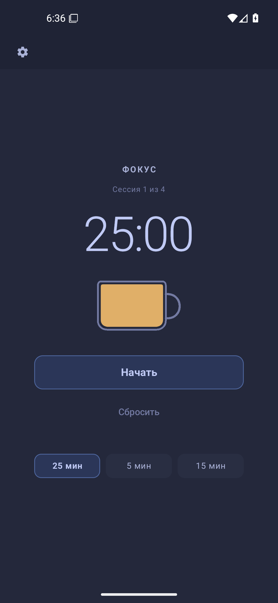
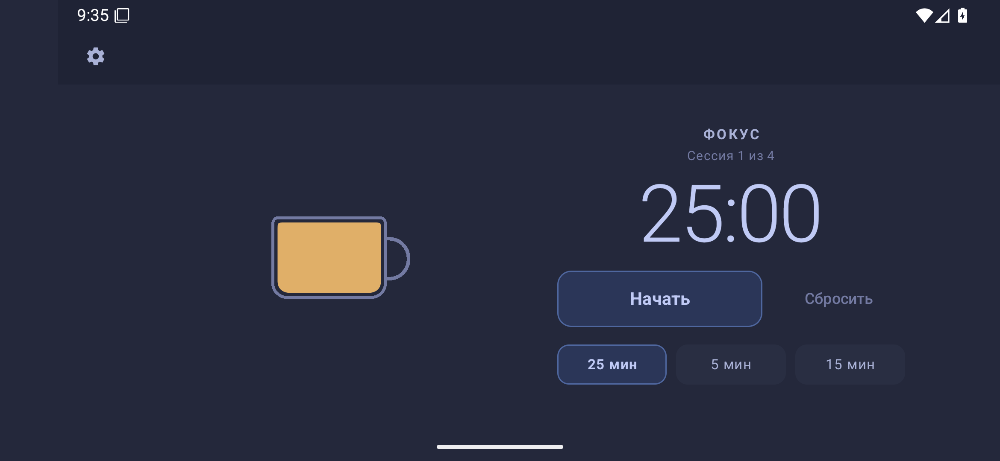

# Brewdoro for Android

An offline Pomodoro timer with an animated coffee cup. Android companion to [Brewdoro for Linux](https://github.com/coreharbor/brewdoro), implemented independently in Kotlin and Jetpack Compose.

**Status:** Linux-style Android preview 0.1.2 with adaptive landscape: 74 JVM tests and 12 UI tests pass, lint has no errors, APK signature verified. Real screenshots and UI smoke checks run on an Android 16/API36 emulator; physical-phone background validation is still pending. Debug-signed development preview, not a production release.

[Verification report](docs/VERIFICATION.md) · [Successful CI](https://github.com/coreharbor/brewdoro-android/actions/runs/38712263952) · [Linux parity criteria](docs/LINUX_PARITY.md)





Landscape adapts to available space; normal-font controls fit without scrolling even at640x360dp. Very short windows/large fonts have scroll fallback with full-width action labels. Rotation/recreation retains running/paused sessions and settings drafts.

**Updating older previews:** uninstall 0.1.0/0.1.1 before installing 0.1.2, because their debug signing certificates differ. Local timer/settings are cleared on uninstall.

## Scope

- Focus, short break and long break; a long break after four focus sessions.
- Animated coffee cup, pause/resume, reset and explicit next-session start.
- Configurable durations, persisted session and local settings.
- Android completion notifications, with transparent permission/fallback behavior.
- Russian and English interface; no account, server, analytics or network permission.

Android 8.0 (API 26) or newer. First development version: 0.1.0.

## Project documentation

- [Architecture](docs/ARCHITECTURE.md)
- [Implementation plan and acceptance gates](docs/PLAN.md)
- [Privacy](PRIVACY.md)
- [Real-device testing](docs/DEVICE_TESTING.md)
- [Production signing](docs/SIGNING.md)

## Build and install

Open the repository in Android Studio, or use JDK 17 and Android SDK platform 35 / build tools 35.0.0:

```sh
./gradlew :app:testDebugUnitTest :app:lintDebug :app:assembleDebug
```

The APK is `app/build/outputs/apk/debug/app-debug.apk`. GitHub Actions produces the same development artifact after successful tests and lint. No SDK or signing keys belong in Git.

## Background timing limitations

The timer uses elapsed-time deadlines, not decrementing UI ticks. Exact background alarms require separate Android access; without it an inexact notification may be delayed. Notifications also require permission on Android 13+. Force-stop and manufacturer power restrictions can prevent delivery. Revoking exact access can cancel alarms until the app is reopened. A crash after recording completion but before posting the notification can lose that notification; it will not double-count the cycle.

No Android 16 device result is claimed until the physical-phone checklist is performed.

MIT licensed. Existing Brewdoro design and behavior are credited to Brewdoro contributors. Android and Linux releases are independent.
